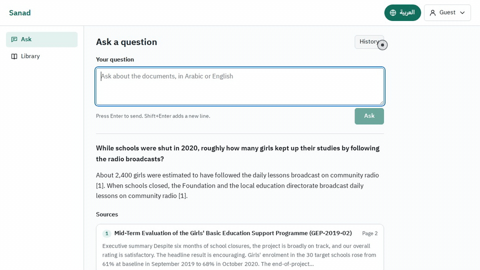
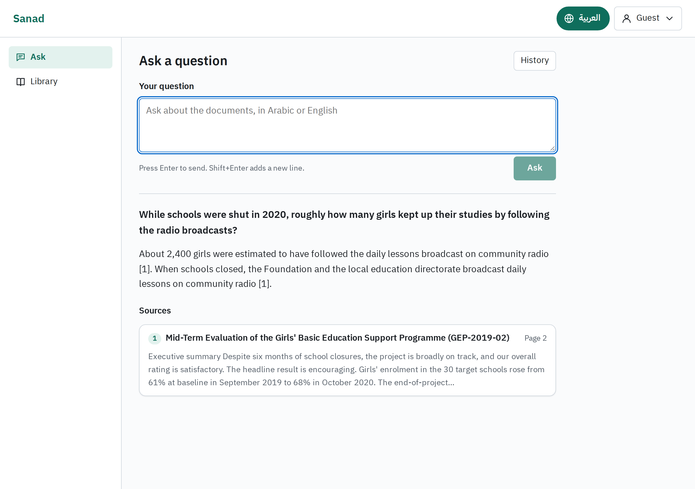
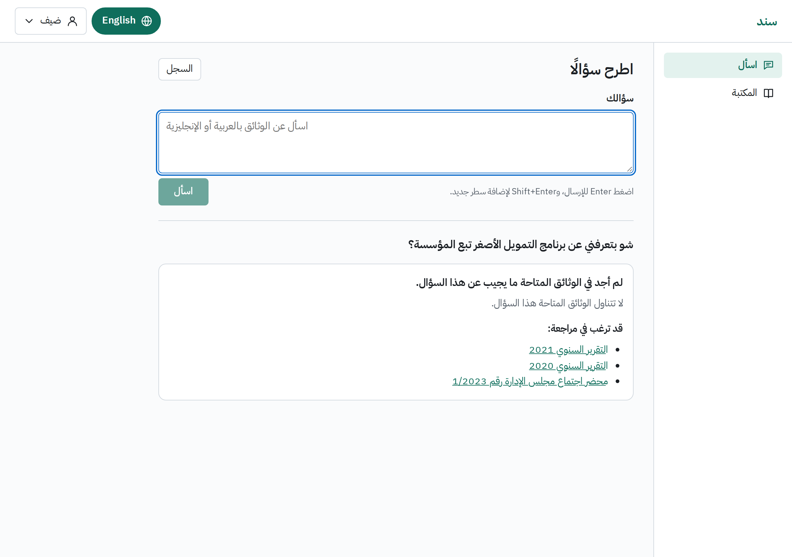
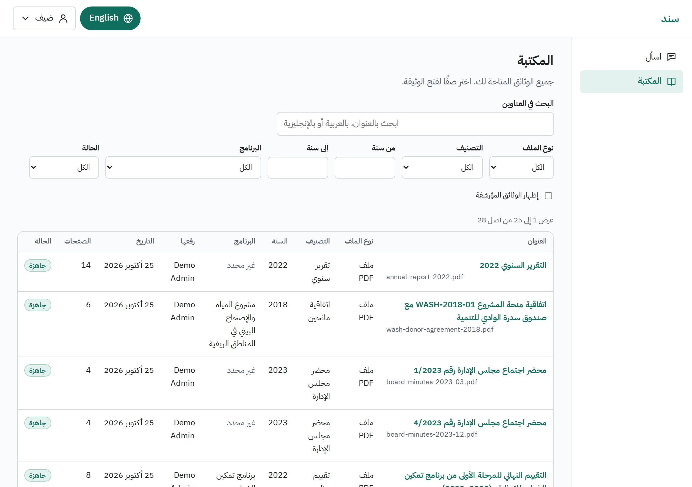
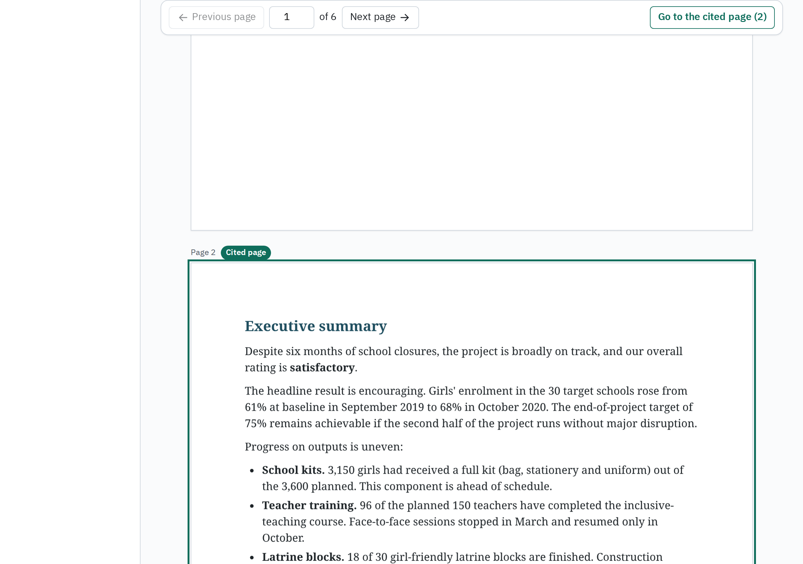
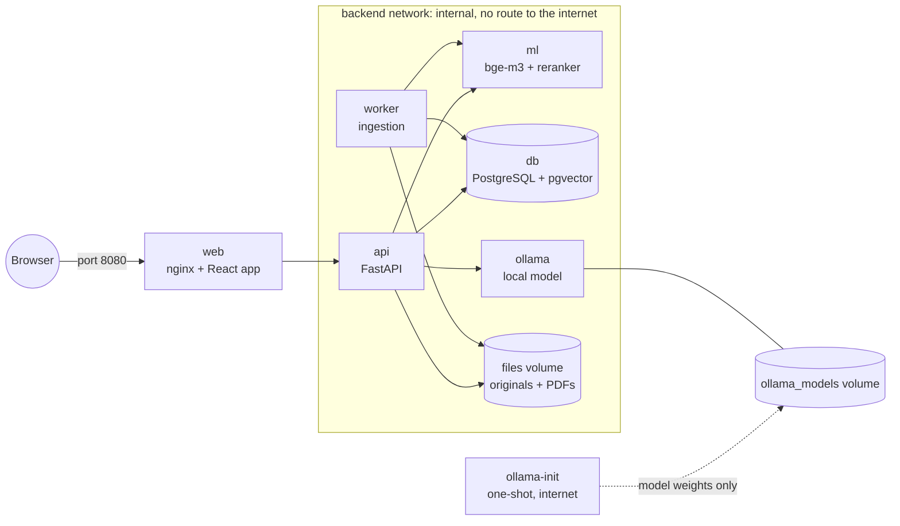

# Sanad: a bilingual document assistant

Sanad answers questions from your organisation's own documents, in Arabic or English. Every
answer cites the document and the page it came from, and one click opens that page. When the
documents don't say, Sanad refuses instead of guessing. It runs on your own server with one
`docker compose` command, and no document content leaves that server. It is built to work
correctly in both directions: the whole interface mirrors between right-to-left Arabic and
left-to-right English, including layout, dates and numbers. Most developers get RTL wrong.

This is a two-week portfolio build, modelled on a real NGO brief ([docs/brief.md](docs/brief.md)).
It works, and it is honest about its limits: see [Deferred to v2](#deferred-to-v2) and
[Limitations](#limitations).

## Contents

- [Demo](#demo)
- [Quick start](#quick-start)
- [What it does](#what-it-does)
- [How it works](#how-it-works)
- [Stack and why](#stack-and-why)
- [Chunking](#chunking)
- [Decisions](#decisions)
- [Can documents leave the server?](#can-documents-leave-the-server)
- [Data handling rule](#data-handling-rule)
- [Evaluation](#evaluation)
- [Deferred to v2](#deferred-to-v2)
- [Limitations](#limitations)
- [Project layout and development](#project-layout-and-development)
- [Credits and licence](#credits-and-licence)

## Demo

After the [Quick start](#quick-start), open the guest link:

**http://localhost:8080/?lang=en**

Click **Continue as guest**. The guest reads the synthetic sample documents only. Then:

1. Ask *"While schools were shut in 2020, roughly how many girls kept up their studies by
   following the radio broadcasts?"* The answer cites page 2 of a programme evaluation.
2. Click the citation card. The document opens at the cited page.
3. Ask *"How many weeks of paid maternity leave do the foundation's employees get?"* The
   documents don't cover it, so Sanad refuses and suggests documents you may want to check.
4. Switch the language in the header. The interface mirrors and keeps your answer on screen.

**Language toggle (15 seconds).** Clip to come: `docs/assets/toggle.gif`.
<!--  -->

**Screenshots.** To come, in `docs/assets/`:

| Screen | File |
|---|---|
| Ask, with an answer and its citations | `docs/assets/ask-citations.png` |
| The refusal state | `docs/assets/refusal.png` |
| The Library, in Arabic | `docs/assets/library-ar.png` |
| The document viewer at a cited page | `docs/assets/viewer.png` |

<!--  -->
<!--  -->
<!--  -->
<!--  -->

## Quick start

**You need:**
- Docker with Compose v2 (Docker Desktop on macOS or Windows). Nothing else: no host Python
  or Node. Images build for both `amd64` and `arm64`.
- **At least 8 GB of memory for Docker.** The stack uses about 6 GB (details below).
- About 25 GB of free disk for images, build cache and model weights.
- An internet connection for the first start only.

```bash
git clone https://github.com/ImamWD/Sanad-Arabic-Document-Assistant.git
```

```bash
cd Sanad-Arabic-Document-Assistant
```

```bash
docker compose up -d --build --wait
```

`make up` does the same and prints the URL. Then open http://localhost:8080/?lang=en
(English) or http://localhost:8080/?lang=ar (Arabic). Without `?lang=`, the interface opens in
English, or in the language you chose last time.

Check that it is healthy:

```bash
curl localhost:8080/api/health
```

It returns `{"status":"ok","db":"ok","ml":"ok"}`.

The 30 sample documents are indexed in the background after the first start, which takes about
two minutes. The Library shows each document's status.

### Demo accounts

| Role | Email | Password |
|---|---|---|
| Admin | `admin@sanad.example` | `admin-demo-2026` |
| Editor | `editor@sanad.example` | `editor-demo-2026` |
| Viewer | `viewer@sanad.example` | `viewer-demo-2026` |
| Guest | the **Continue as guest** button | none |

These passwords are public: anyone can read them here. They work out of the box because the
stack starts in demo mode, which logs a warning naming every public default still in use. On
any real deployment, set `SANAD_ENV=production` in `.env`. The stack then refuses to start
until `DEMO_ADMIN_PASSWORD`, `DEMO_EDITOR_PASSWORD`, `DEMO_VIEWER_PASSWORD` and
`POSTGRES_PASSWORD` are changed and `SESSION_COOKIE_SECURE` is `true` (which needs HTTPS). Set
them before the first start; you can also deactivate the demo accounts in Admin.

### What the first start downloads

| What | Size (approx.) |
|---|---|
| Base images: PostgreSQL with pgvector, Python, Node, nginx, Ollama | about 4 GB |
| LibreOffice, poppler and Arabic fonts (Debian packages), Python and npm packages | about 1.5 GB |
| `BAAI/bge-m3` and `BAAI/bge-reranker-v2-m3` weights, converted to int8 ONNX during the build | about 4.5 GB |
| The local language model, `gemma4:e4b-it-qat`, pulled into a Docker volume | 6.1 GB |

That is roughly 15 GB. **Estimate:** 30 to 60 minutes on a typical home connection, most of it
downloading. Measured on a clean machine: TBD. After the first start, Sanad runs offline and
starts in under a minute.

### Memory

The default configuration uses about 6 GB of RAM: the local model takes about 3.4 GB, the
embedding and reranking models about 1.5 to 2 GB, and the rest of the stack under 1 GB. So
8 GB for Docker is enough. Check what Docker has:

```bash
docker info --format '{{.MemTotal}}' | awk '{printf "%.1f GiB\n", $1/1073741824}'
```

It should print at least 7.5 GiB. With less, the operating system can stop the model in the
middle of an answer, and the screen says "The answer service is not available right now". The
figures were measured in a Linux container with an 8 GB Docker VM; see the model spike
([docs/spikes/S3-local-llm.md](docs/spikes/S3-local-llm.md)).

### Stop and reset

Stop the stack and keep all data:

```bash
docker compose down
```

Delete the documents, accounts and question history, but keep the downloaded model:

```bash
docker compose down
```

```bash
docker volume rm sanad_db_data sanad_files
```

Delete everything, the model weights included (the next start downloads 6.1 GB again):

```bash
docker compose down -v
```

The model volume `sanad-ollama-models` is shared by every Sanad stack on the machine, so
`down -v` removes it for all of them.

### Configuration

Every setting has a working default. To change one, copy the example file and edit it:

```bash
cp .env.example .env
```

[.env.example](.env.example) explains each setting in a comment.

## What it does

| Area | What you get |
|---|---|
| **Bilingual interface** | Arabic (right to left) and English (left to right), fully mirrored. Switch at any time without losing your place. `?lang=ar` and `?lang=en` work on every page. |
| **Digits** | Latin digits (123) by default in both languages, the client's choice. Arabic-Indic digits are a setting (`AR_NUMBERING=arab`). |
| **Arabic text handling** | Alef and hamza forms, taa marbuta, tatweel, diacritics and Arabic-Indic digits are normalised before matching. The original text is kept for display. A search for `التعليم` matches `التعليــم`. |
| **Ingestion** | PDF, DOCX and TXT. Each file shows its stage: uploading, queued, extracting text, indexing, ready. A failed file shows a readable reason, such as "This file has no text layer (scanned image)". |
| **Upload** | Several files at once. Each file is processed on its own, so one bad file never stops the others. |
| **Chunking** | Page-bounded, paragraph-aligned chunks of about 350 tokens. See [Chunking](#chunking). |
| **Embeddings** | `BAAI/bge-m3`, run locally on the CPU. |
| **Answers** | Generated only from retrieved excerpts, with a `[n]` citation after each claim. Each citation names the document and page. Click it and the viewer opens at that page. |
| **Refusal gate** | Three bands: refuse, answer under an amber "check the sources" banner, or answer normally. An answer with no valid citation becomes a refusal. |
| **Never looks frozen** | The answer streams word by word. Before that, the screen says what is happening (searching, reading the sources, writing), and warns up front when an answer may take more than about 20 seconds. |
| **History** | Each user sees their own past questions and answers. |
| **Library** | Search titles in Arabic or English. Filter by file type, category, year, programme, status and access. Editors edit details, restrict, archive and retry. |
| **Viewer** | The PDF, page by page, opened at the cited page. A page from a converted Word file says that its page number may differ from Word. |
| **Roles** | Viewer, Editor and Admin. Restricted documents are visible to Editors and Admins only, and are excluded from *retrieval* for Viewers, not just hidden. |
| **Admin** | Add users, change roles, deactivate accounts. Accounts are never deleted. |
| **Guest** | Read-only access to the synthetic sample documents. It never reaches a real document. |
| **Evaluation** | 15 headline questions with expected answers, a runner, and a score. See [Evaluation](#evaluation). |
| **One command** | `docker compose up` brings up the whole system on a clean machine. |

## How it works



| Service | What it does |
|---|---|
| `web` | nginx serves the React app and forwards `/api` to `api`. The only published port. |
| `api` | FastAPI: sign-in, roles, documents, and the question pipeline. |
| `worker` | Ingestion: convert, extract, clean, chunk, embed, store. Same image as `api`. |
| `ml` | Embeddings (`bge-m3`) and reranking (`bge-reranker-v2-m3`), int8 ONNX on the CPU. Weights are built into the image. |
| `db` | PostgreSQL 16 with pgvector: users, documents, pages, chunks, vectors, questions. Also the job queue. |
| `ollama` | The local language model. It sees every prompt, so it has no internet route. |
| `init` | One-shot: database migrations, demo accounts, programmes and the sample documents. |
| `ollama-init` | One-shot: downloads the model weights into a volume on the first start. It never sees a prompt or a document. |

**Upload to ready.**
1. An editor uploads a file. `api` checks its type by content, stores it and queues it.
2. The `worker` picks it up. It converts DOCX and TXT to PDF with LibreOffice, so every
   document has real pages and one viewer.
3. It extracts the text of each page (poppler's `pdftotext`, with pypdfium2 as the fallback),
   and fails clearly on scanned, encrypted or broken files.
4. It cleans the text, splits each page into chunks, has `ml` embed them, and stores them in
   one transaction. The document is ready.

**Question to answer.**
1. `api` normalises the question and has `ml` embed it.
2. Two searches run on the documents the user may see: vector search (meaning) and word search
   (exact names, codes and numbers). Their results are fused into one candidate list
   (`RERANK_CANDIDATES`, 30 by default).
3. `ml` reranks the candidates. The best score decides the band. Below the refusal threshold,
   the model is never called and Sanad refuses.
4. Otherwise the best few excerpts (`RETRIEVAL_TOP_K`, 6 by default) go to the local model,
   numbered `[1]`, `[2]` and so on. It must answer in the question's language, from the
   excerpts only, cite every claim, and reply `NO_ANSWER` if the excerpts don't contain the
   answer.
5. The answer streams to the browser. A final check drops citations that point nowhere. If no
   valid citation is left, or the model said `NO_ANSWER`, the streamed text is replaced by a
   refusal.

The full design is in [docs/SYSTEM_DESIGN.md](docs/SYSTEM_DESIGN.md).

## Stack and why

- **Python 3.12 and FastAPI.** The best ecosystem for PDF extraction, embedding models and
  Arabic text. FastAPI's OpenAPI spec generates the frontend's TypeScript types.
- **PostgreSQL with pgvector.** One database holds the records, the vectors and the word index.
  The IT person runs and backs up one thing.
- **A job queue in PostgreSQL** (`FOR UPDATE SKIP LOCKED`), instead of Redis and Celery. At a
  few hundred documents a year, a broker is one more moving part for nothing.
- **ONNX Runtime with int8 models** in `ml`. No PyTorch at runtime and about 1.5 to 2 GB of
  memory. The build checks both models against the originals, and they were measured on Intel
  and ARM.
- **Ollama with Gemma 4 E4B.** The only model in our test that passed every check on every run:
  exact `NO_ANSWER`, citations on every claim, resistance to instructions hidden in a document,
  and the question's language. Served text-only so the whole stack fits in 8 GB.
- **React, TypeScript and Vite.** TanStack Query caches server data, so switching language never
  refetches. i18next holds every string in `ar.json` and `en.json`.
- **CSS Modules with logical properties only** (`margin-inline-start`, never `margin-left`).
  Stylelint enforces it, which is what makes mirroring complete.
- **pdf.js** for the viewer. **LibreOffice** for DOCX and TXT conversion. **poppler** for text
  extraction: on the sample corpus it read Arabic more faithfully than pypdfium2, and far more
  so with some fonts.

## Chunking

Decision D1, in plain words:

- **Chunks never cross a page.** Every chunk belongs to exactly one page, so every citation
  points to one page you can open. The client said they would rather have a slightly worse
  chunk than a citation they cannot trust.
- **Chunks follow paragraphs.** A chunk is built from whole sentences and closes at a paragraph
  break when it is at least half full. It splits only at a sentence or clause boundary, and the
  Arabic question mark, comma and semicolon (`؟` `،` `؛`) count as boundaries.
- **Size is measured in tokens, not characters or words.** Arabic attaches small words to
  others: "وبالمشروع" is "and with the project" in one word. So character and word counts both
  mislead. Sanad counts tokens with the embedding model's own tokenizer.
- **About 350 tokens per chunk, never more than 512.** That is one or two Arabic paragraphs:
  enough to hold a figure with its programme and year, and focused enough to rank well.
- **About 15% overlap** (50 tokens, rounded to whole sentences) between neighbouring chunks on
  the same page, so a fact near a boundary is not lost.
- **A short page tail merges.** If the last piece of a page is under 80 tokens, it joins the
  chunk before it.
- **Each chunk is embedded with its document's title, programme and year in front.** The stored
  text is unchanged. This helps a question that names a programme find the right document.

The settings are `CHUNK_TARGET_TOKENS`, `CHUNK_MAX_TOKENS`, `CHUNK_OVERLAP_TOKENS` and
`CHUNK_MIN_TAIL_TOKENS` in `.env.example`. The cost of page-bounding is that a paragraph running
across a page break is split. See [Limitations](#limitations).

## Decisions

The client asked for one running list of what they decided. It is
[docs/BUILD_PLAN.md](docs/BUILD_PLAN.md), Part 2. The reasoning behind each decision is in
[docs/DECISIONS.md](docs/DECISIONS.md). Condensed:

### Technical decisions

| # | Question | Decision |
|---|---|---|
| D1 | Chunk size and overlap | Page-bounded, paragraph-aligned, about 350 tokens, 512 maximum, about 15% overlap. See [Chunking](#chunking). |
| D2 | Embedding model | `BAAI/bge-m3`, 1024 dimensions, run locally. A hosted embedding API would cost only a few dollars per 1,000 documents, but it would receive every page of every document. |
| D3 | Local model or API for answers | Local only. The hosted-API code stays behind a deliberate override, for benchmarks on synthetic data. It is never enabled for the client's documents. |
| D4 | Weak but non-empty search results | A three-band gate biased toward refusing: refuse, answer with an amber low-confidence banner, or answer. The model replies `NO_ANSWER` when the excerpts don't contain the answer. Any answer without a valid `[n]` citation becomes a refusal. |
| D5 | Updated documents | Deferred to v2. The client's decision, for the record: a full rewrite becomes a new version, an amendment letter sits alongside as a linked document, and the whole chain is visible in date order. |
| D6 | Citation depth | Page level for this build. Paragraph-level highlighting is v2. |

On D2, the client asked for this sentence to appear here, in exactly these words:

Cost is not the reason to stay local; privacy is.

### The client's answers

| # | Question | Answer |
|---|---|---|
| Q1 | May a hosted model receive excerpts? | No. Local only. Masking names and IDs is not enough: donor agreements hold confidential commercial terms. |
| Q2 | Restricted documents? | Yes. One `restricted` flag, for Editors and Admins only. A Viewer must never receive an answer drawn from a restricted document, even uncited, so it is excluded from retrieval. |
| Q3 | Scanned documents? | The client estimates 15 to 20% of the archive. They fail clearly as "no text layer (scanned image)" rather than being indexed empty. |
| Q4 | Guest account? | Sample data only. It never reaches a real document. |
| Q5 | What is "type" in the Library? | Both file type and category. Six categories: annual report, donor agreement, programme evaluation, field survey, budget, board minutes. A document that fits none is flagged, not given an invented category. |
| Q6 | Digits in the Arabic interface? | Latin (123) by default in both languages, switchable in config. That is how the client writes reports and how donors read them. |
| Q7 | Usage log retention? | 12 months, then automatic deletion. The detailed log is v2. |
| Q8 | Server? | 16 CPU cores, 64 GB of RAM, no GPU. |
| Q9 | Scale? | 300 to 400 new documents a year, under 20 accounts, 5 to 8 at the same time. |
| Q10 | Real sample documents? | Eight annual reports, already public. They are not in this repository: the demo uses a synthetic corpus. |

### Behaviour the client added in review

- The Ask screen must never look frozen. It streams the answer, names the current stage, and
  warns before a long wait.
- Streaming never weakens the refusal rule. If the final check rejects an answer, the streamed
  text is replaced by the refusal. The amber banner appears before the first word, not after.
- Refusals come in two kinds: "the documents don't cover this question" and "some passages were
  read, but nothing usable was found in them". That tells honesty apart from a search problem.
- A citation from a converted Word file says that its page number may differ from Word's.
- Network isolation is stated in one plain paragraph that the client's IT person can point to:
  the next section.

## Can documents leave the server?

No. Every container that handles document content (`api`, `worker`, `ml`, `db` and `ollama`)
is attached only to a Docker network declared `internal: true`, which has no route to the
internet. Only `web` publishes a port, and it only serves the app and forwards requests to
`api`. The one container with internet access, `ollama-init`, downloads the model weights on
the first start and never sees a prompt or a document. The embedding and reranking weights are
built into the `ml` image and loaded offline. There are no CDN assets, web fonts from outside
or analytics. A hosted-model override (`docker-compose.yml` plus `docker-compose.api-llm.yml`)
exists only for benchmarks on the synthetic sample data. It is not enabled by default, and even
when applied by mistake, the code refuses to send any excerpt that does not come from the
sample corpus (error `HOSTED_LLM_NON_SEED_DATA`).

To check a running stack, list the compose files it was started with:

```bash
docker compose ls
```

The `CONFIG FILES` column must show `docker-compose.yml` only, never `docker-compose.api-llm.yml`.
Then try to reach the internet from `api`. This must fail:

```bash
docker compose exec -T api python -c "import socket; socket.create_connection(('1.1.1.1', 443), timeout=5); print('REACHED THE INTERNET')" 2>&1 | tail -n 1
```

It prints `OSError: [Errno 101] Network is unreachable`. If it ever prints
`REACHED THE INTERNET`, isolation is broken. The same command works for `worker` and `ml`. CI
runs a probe like it on every pull request.

## Data handling rule

This rule was agreed with the client and is binding. It applies to everyone who works on the
system, including AI coding assistants:

> No content from the Foundation's archive is ever sent to any external service, including AI coding assistants, under any circumstances, **including debugging**. Diagnosis uses file names, error messages, page counts and extracted statistics only. If a document must be examined, it is examined on the Foundation's own server.

The one exception is the client's eight sample reports, which are already public.

## Evaluation

Most portfolios are screenshots. This one ships a score.

### Run it

Start the stack first, with only the sample documents in it. The runner refuses to score a
stack that holds anything else.

```bash
make eval EVAL_FLAGS="--hardware 'Apple M5, CPU, 8 GB Docker'"
```

Without `make`:

```bash
docker compose run --rm backend-dev python -m sanad.eval --set test --hardware 'Apple M5, CPU, 8 GB Docker'
```

Describe your own machine in `--hardware`. The runner signs in as the demo editor, asks each
question over the HTTP API, through the same pipeline the browser uses, and prints
`Score: X/15` last. It writes a
Markdown and a JSON report to `eval/results/`, with the model, hardware, Ollama version, commit
and date. `make eval-dev` runs the 30 tuning questions. `--help` lists every option.

### How it is scored

- **An answerable question is correct** only if all three hold: Sanad answers (with or without
  the amber banner), every expected fact is in the answer, and at least one citation is an
  expected page. Facts are compared after normalisation, so `1,840`, `1840` and the same number
  in Arabic-Indic digits match, but `538` does not match inside `1538`.
- **An unanswerable question is correct** only if Sanad refuses.
- **Each failure gets one cause:** an invented answer (an unanswerable question was answered,
  the worst case), a page split, a false refusal, a retrieval miss (the right page was not
  among the candidates), or a generation miss (the page was there, but the facts or the
  citation were wrong). A failed request counts as wrong and flags the run.

### Why 15 questions, and the dev/test split

The plan called for 25. To fit the two-week build, the headline set was cut to 15, and the
other 10 moved to the tuning set. Fifteen still covers what matters:

- 8 Arabic factual questions, including one with tatweel, one fully diacritised, one with a
  project code inside Arabic text, and one whose fact sits in a paragraph split by a page break
- 2 questions that need two documents
- 2 English questions, one of them about an Arabic document
- 3 questions the documents cannot answer, two of them near misses where a related document
  exists

The thresholds, prompts and retrieval settings are tuned only on the **dev** set
(`eval/dev_questions.yaml`, 30 questions). The 15 **headline** questions
(`eval/questions.yaml`) are never used for tuning, and the two sets share no question and no
answer fact. So the headline score is not fitted to its own questions. All answers come from
the synthetic corpus described in [seed/README.md](seed/README.md).

### Results

| Model | Role | Hardware | Score | Invented answers | Median / p90 answer time | Date |
|---|---|---|---|---|---|---|
| `gemma4:e4b-it-qat`, text-only | Shipped default (CPU) | TBD | TBD / 15 | TBD | TBD | TBD |
| `gemma4:26b-a4b-it-qat` | Optional, for GPU hosts | TBD | TBD / 15 | TBD | TBD | TBD |

### Questions it fails and why

TBD after the final run.

| ID | Kind | Cause | Why |
|---|---|---|---|
| TBD | TBD | TBD | TBD |

## Deferred to v2

These were designed and then cut to fit two weeks. They are listed so nobody thinks they exist.

- **Document versions:** new versions, superseded documents leaving search, and the amendment
  chain of a donor agreement.
- **Paragraph-level highlighting:** citations open the right page; they don't highlight the
  passage yet.
- **The detailed usage log for Admins:** who asked what, the refused / low-confidence /
  answered counts over time, and the 12-month automatic deletion.
- **Bulk upload of a whole archive:** the build has a simple multi-file upload.
- **Everything GPU:** hardware choice, GPU benchmarks and measured GPU answer times.
- **Switching to a hosted model in production:** the provider abstraction and the override file
  exist for synthetic benchmarks only. The build ships local only.

## Limitations

- **Page numbers of DOCX and TXT files refer to the converted PDF.** Word has no fixed pages, so
  Sanad converts to PDF and cites that. The citation card and the viewer say so.
- **Page-bounded chunks can split a paragraph** that runs across a page break. A fact in the
  second half may then lose its context. The evaluation tracks this as its own failure cause.
- **Scanned PDFs are not read.** There is no OCR. A scan fails with `NO_TEXT_LAYER`, shown as
  "no text layer (scanned image)", instead of being indexed empty.
- **Answers are slow on a CPU:** usually 30 to 60 seconds on a laptop, longer under load. The
  screen streams the answer and shows the stage and elapsed time, so it never looks frozen. A
  refusal from the gate is faster, because the model is not called. Production speed needs a
  GPU.
- **A known poppler quirk with some Arabic fonts:** it can insert a space inside a word (after
  ر before ي or ب, as in `الر يحان`), and on fully diacritised text it moves the marks. On the
  sample corpus, 97% of words come out exactly as written.
- **One answer at a time.** On a CPU the model handles one question at a time. Others wait, and
  the screen shows their place in the queue.
- **The Ask screen has no filter controls yet.** The API accepts programme, year and category
  filters; the screen doesn't offer them.

## Project layout and development

```
backend/    Python package `sanad`: api, worker, ingestion, retrieval, LLM adapters, eval
ml/         embedding and rerank service (int8 ONNX)
frontend/   React app; all UI text in src/locales/ar.json and en.json
deploy/     nginx config, the model download script
seed/       synthetic sample corpus (sources, rendered files, manifest)
eval/       headline and dev question sets; results/
docs/       brief, build plan, decisions, design, roadmap, spike reports
```

Everything runs in containers. `make help` lists the targets.

| Command | What it does |
|---|---|
| `make up` | Build and start the stack, wait until healthy, print the URL |
| `make down` | Stop the stack (data is kept) |
| `make logs` | Follow the logs |
| `make lint` | No em dashes; ruff and mypy (backend, ml); tsc, ESLint, stylelint and prettier (frontend) |
| `make test` | pytest (backend, ml) and vitest (frontend) |
| `make test-e2e` | Playwright against the running stack |
| `make eval` / `make eval-dev` | Score the 15 headline / 30 dev questions against the running stack |
| `make fmt` | Format Python and frontend code |
| `make gen-api-types` | Regenerate the frontend's API types from the FastAPI spec |

The lint gates are errors, not warnings:
- ESLint `i18next/no-literal-string`: no UI text outside the locale files. A test checks that
  `ar.json` and `en.json` have the same keys, and that every server error code is translated.
- Stylelint: CSS logical properties only, so the layout mirrors.
- The server returns error codes, never prose. The client translates them.
- All Arabic matching goes through one module, `sanad.text.arabic`, with its own tests.

CI runs lint, the unit tests, a healthy `make up`, the egress probe and the Playwright suite on
every pull request.

**Two stacks on one machine.** `SANAD_INSTANCE` names the compose project and tags the images,
so two checkouts never share containers, volumes or images. `make` picks a name and port inside
a git worktree (`make info` shows them). Plain `docker compose` means the default `sanad` stack
unless you set `SANAD_INSTANCE`.

**Development override.** `make up-dev` adds `docker-compose.dev.yml`: hot reload, and a route
from `api` to an Ollama running on the host for speed. It relaxes isolation on purpose, so never
use it with real documents. The no-egress guarantee applies to `docker-compose.yml` alone.

The working documents behind the build are in `docs/`: the client brief, the build plan and
decisions log, the decisions with their reasoning, the system design, the roadmap, and the
model spike report.

## Credits and licence

**Licence:** to be decided by the owner.

**Models**

| Model | Use | Licence |
|---|---|---|
| [`BAAI/bge-m3`](https://huggingface.co/BAAI/bge-m3) | Embeddings | MIT |
| [`BAAI/bge-reranker-v2-m3`](https://huggingface.co/BAAI/bge-reranker-v2-m3) | Reranking | Apache 2.0 |
| Gemma 4 E4B (`gemma4:e4b-it-qat`, Google) | Answers | Apache 2.0 |

Gemma 4 is released under Apache 2.0, as `ollama show gemma4:e4b-it-qat --license` prints.
Earlier Gemma generations used Google's own Gemma Terms of Use. The model choice and its tests
are in [docs/spikes/S3-local-llm.md](docs/spikes/S3-local-llm.md).

**Software:** FastAPI, SQLAlchemy, PostgreSQL and pgvector, ONNX Runtime, Ollama, LibreOffice,
poppler (called as a separate program), pypdfium2, React, TanStack Query, i18next, Radix UI,
pdf.js, and the IBM Plex Sans Arabic, Amiri and Noto fonts.

**Sample data:** the documents in `seed/` are synthetic. The organisation, people, IDs and
figures are invented.
